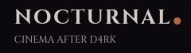

# NOCTURNAL - The Halloween Film Browser

#### Browser films and choose your next halloween spooky watch!

Made using HTML, CSS and JS

---

### A real spooky vibe

### Browse our film collection

### Search for movies

### Watch our favorites

### MORE than just movies

### Vast Horror Collection

---

## How to use/run

You can enjoy browsing movies NOW on:
https://nocturnalmovies.vercel.app

Take a look at our vast collection and enjoy!

---

## The Story Behind NOCTURNAL

So basically I was thinking about my next project for terra since I had no clue what to do and since it was halloween I wanted to follow the theme as well.

So I was taking a shower and suddenly, an idea poofed into my head! A horror movie browser.

But to be frank, I don't even watch horror movies...

So, since I had no better idea than this, (everything else was either too hard or I'd done it already) I started off with some research and just pulled random movies off the internet and calculated their ratings using IMDb and what people on reddit were saying.

I also added a normal movies section for the favorites so I had a say in this...

well, I guess that's about it...

